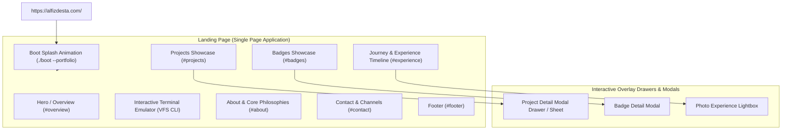
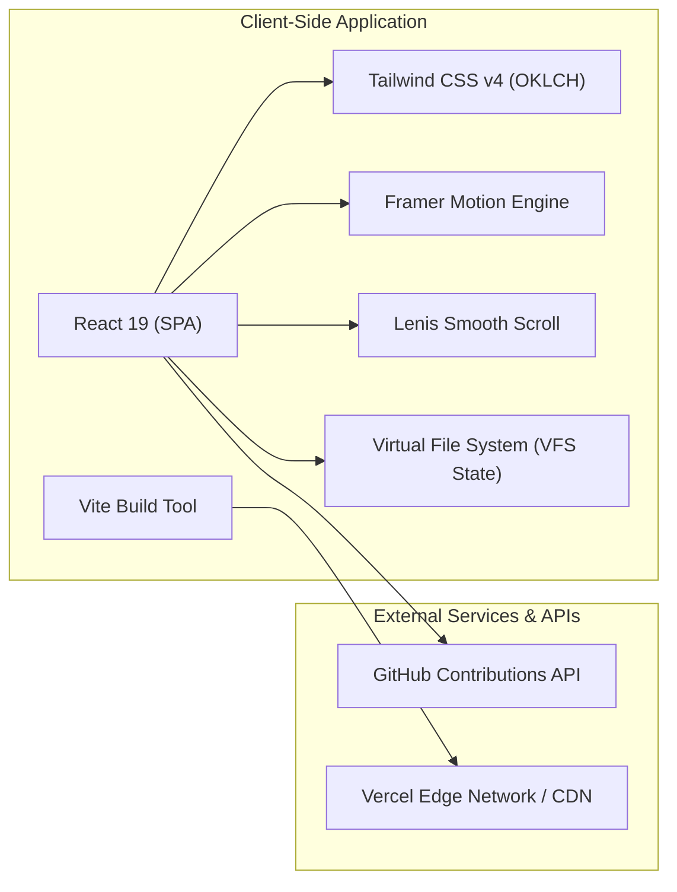

# Product Requirement Document (PRD) — Personal Portfolio

| Document Information | Detail |
| :--- | :--- |
| **Product Name** | Alfiz Desta Portfolio Platform |
| **Live URL** | (https://alfizdesta.com) |
| **Owner / Subject** | Alfiz Desta Ariant Permana (Software Engineering, Universitas Gadjah Mada) |
| **Document Version** | 1.1.0 (Refined Architecture) |
| **Status** | Planning & Design Phase (Figma / Figcraft First) |
| **Target Deployment** | Vercel Edge Network |
| **Primary Stack** | React 19 (SPA) + Vite, Tailwind CSS v4, Framer Motion, Lenis Scroll |
| **Project Detail UX** | Interactive Modal Drawer / Sheet (In-Page) |


## Project Overview
    - **Nama Pemilik:** Alfiz Desta Ariant Permana
    - **Role:** Software Engineer
    - **Works on:** Backend Developer
    - **Languages:** TypeScript, PHP, Python
    - **Frameworks:** Laravel, Next.js
    - **Databases:** PostgreSQL, Redis, MySQL
    - **Interest:** DevOps, Computer Vision
    - **Status Saat Ini:** Available for Opportunities

---

### Struktur Halaman (urutan section)
1. **Hero** — Overview
2. **About** 
3. **Project**
4. **Experience**
5. **Badges** 
6. **Contact**
7. **Footer**

---

## Core Links & Kontak
    - **Email:** alfizdestaap@gmail.com
    - **GitHub:** https://github.com/exenthiast
    - **LinkedIn:** https://www.linkedin.com/in/alfiz-desta-0a0318326/
    - **Resume / CV Link:** /CV-ALFIZ REAL.pdf
    - **Lokasi / Zona Waktu:** Yogyakarta, Indonesia (GMT+7)

---

## 1. Executive Summary & Product Vision

### 1.1 Product Overview
**alfizdesta.com** adalah personal portfolio dan platform engineering showcase interaktif milik **Alfiz Desta Ariant Permana**, seorang Software Engineering student 
di Universitas Gadjah Mada (UGM). Platform ini dirancang bukan sekadar sebagai resume online statis, melainkan representasi interaktif dari keahlian teknis 
(*craftsmanship*) pemiliknya dalam membangun produk digital *end-to-end* (Web Apps, Backend/APIs, Cloud Infrastructure).

### 1.2 Product Vision
Menjadi standar portfolio rekayasa perangkat lunak modern yang menggabungkan:
1. **Interactive Developer-Native UX**: Integrasi terminal emulator (CLI) lengkap dengan *Virtual File System* (VFS) dan simulated boot loader.
2. **Comprehensive Engineering Case Studies**: Penjelasan mendalam mengenai arsitektur sistem, skema data, skalabilitas, dan integrasi AI pada proyek-proyek riil.
3. **Verified Track Record**: Dokumentasi riwayat kepemimpinan organisasi teknologi, kepanitiaan nasional, dll.
4. **Production-Grade Performance & Accessibility**: Animasi halus dengan optimasi resource (Lenis, Framer Motion, WebP, `prefers-reduced-motion`).

---

## 2. Target Audience & User Personas

| Persona | Profil & Karakteristik | Tujuan Utama (User Goals) | Kebutuhan Fitur |
| :--- | :--- | :--- | :--- |
| **Tech Recruiter / HR Talent** | Perekrut dari tech startup, unicorn, atau software house. Waktu review singkat (< 2 menit). | Memverifikasi kualifikasi teknis,
    status pendidikan (UGM 2024–2028), riwayat magang/freelance, dan kesiapan magang/kerja. | Ringkasan cepat (Overview), tombol direct contact (LinkedIn, Email), 
    statistik proyek, status ketersediaan kerja. |
| **Engineering Manager / Tech Lead** | Senior engineer yang mengevaluasi kedalaman teknis dan *system thinking*. | Menilai arsitektur kode, pemilihan tech stack,
    penanganan concurrency, data modeling, dan pipeline CI/CD. | Detail halaman proyek (`/projects/:slug`), tab Arsitektur, tautan repository GitHub aktif, diagram/spek backend. 
| **Fellow Developers & Student Community** | Komunitas developer mahasiswa, junior engineer, rekan organisasi. | Melihat referensi desain portfolio, 
    mengeksplorasi terminal emulator, dan berkolaborasi. | CLI Terminal interaktif (`whoami`, `neofetch`, `grep`, `tail -f`), GitHub live contribution graph, 
    dokumentasi foto kegiatan. |

---

## 3. Information Architecture (IA) & Sitemap



### 3.1 Sitemap Specification (`sitemap.xml`)
- Base URL: `https://alfizdesta.com/` (Single Page Application dengan in-page Modal Drawer untuk detail proyek & lencana).
- Desain UI/UX dipersiapkan terlebih dahulu melalui Figma / Figcraft sebelum implementasi coding.

---

## 4. Detailed Feature & Functional Requirements

### 4.1 Feature 1: Boot Sequence & Loading Screen (`./boot --portfolio`)
* **Deskripsi**: Simulasi proses booting "alfizdesta." saat website pertama kali dimuat.
* **Spesifikasi UI/UX**:
  * Tampilan cerah (`#fafbff`).
  * Transisi mulus (*fade out*) ke antarmuka utama setelah booting selesai.

---

### 4.2 Feature 2: Interactive In-Browser Terminal Emulator
* **Deskripsi**: Terminal virtual lengkap dengan *Virtual File System* (VFS) direktori UNIX-like untuk eksplorasi portfolio berbasis keyboard maupun klik.

* **Daftar Perintah Terminal**:
  | Perintah | Argumen / Flag | Deskripsi | Kategori |
  | :--- | :--- | :--- | :--- |
  | `help` | `[command]` | Menampilkan daftar perintah atau dokumentasi manual perintah tertentu. | Shell |
  | `ls` / `ll` / `dir` | `[-l] [path]` | Menampilkan isi direktori virtual dengan opsi mode list format permissions (`drwxr-xr-x`). | Explore |
  | `cd` | `<dir>` | Berpindah direktori kerja di VFS (`..`, `~`, `./projects`, dll). | Explore |
  | `pwd` | - | Menampilkan path direktori aktif saat ini. | Explore |
  | `cat` / `less` / `more` | `<file>` | Membaca isi file virtual (misal `cat ./about.md`). | Read |
  | `tail` | `[-f] <file>` | Menampilkan entri perjalanan/log terbaru dari experience. | Read |
  | `grep` | `[-r] <pattern>` | Melakukan pencarian teks di seluruh proyek dan log perjalanan. | Read |
  | `open` | `<path>` | Melakukan scroll otomatis atau navigasi langsung ke halaman/seksi terkait. | Explore |
  | `whoami` | `[--stats]` | Menampilkan bio singkat atau angka ringkasan statistik. | Read |
  | `neofetch` | - | Menampilkan ringkasan sistem spesifikasi teknis dan bahasa pemrograman. | Read |
  | `contact` | `[--open-channel]` | Menampilkan informasi kontak dan channel media sosial. | Read |
  | `history` | - | Menampilkan riwayat perintah yang telah dijalankan di sesi aktif. | Shell |
  | `echo` | `<text>` | Mencetak kembali teks ke terminal. | Shell |
  | `date` | - | Menampilkan waktu dan tanggal saat ini. | Shell |
  | `clear` / `cls` | - | Membersihkan tampilan layar terminal (mendukung shortcut `Ctrl+L`). | Shell |
  | `sudo` | `<cmd>` | Easter egg: menolak eksekusi dengan pesan otentikasi. | Shell (Hidden) |
  | `exit` | - | Easter egg shell termination. | Shell (Hidden) |
* **Fitur Interaktivitas Cerdas**:
  * Auto-suggestion / "Did you mean?": Jika user salah mengetik path, sistem menawarkan saran yang dapat diklik langsung untuk mengeksekusi perintah.
  * Clickable Command Pills: Teks terminal yang berupa perintah dapat langsung diklik oleh pengguna non-teknis tanpa perlu mengetik manual.

---

### 4.2 Feature 3: Navbar
    - Logo dengan nama inisial, samping logo: "Alfiz Desta.", bawah nama: "Software Engineer".
    - Navigasi cepat: Overview, About, Projects, Experience, Badges , Contact.
    - CTA Button: Github, Linkedin.

### 4.2 Feature 4: Hero Section / Halaman Overview
    Tampilan dengan background berwarna putih, menampilkan 4 card dengan tema terminal mac neofetch di sisi pojok atas (kiri dan kanan), pojok
    bawah (kiri dan kanan). 
    - Card 1 (kiri atas, menyerong ke kanan bawah): judul/nama (~/project/2025-2026), isi: jumlah project (misal: 4), kotak stack + nama di 
      bawah kotak stack(stack project). Kotak stack jika di hover mengubah nama stack menjadi project, jika di klik akan mengarahkan ke project.
    - Card 2 (kanan atas, menyerong ke kiri bawah): judul/nama (~/badges/alfiz), isi: jumlah badges (misal: 4), kotak stack + nama di bawah kotak 
      stack(item badges). Kotak stack jika di hover mengubah nama stack menjadi badges, jika di klik akan mengarahkan ke badges.
    - Card 3 (kiri bawah, menyerong ke kiri bawah): judul/nama (~/experience/2024-2026), isi: jumlah experience (misal: 4), menampilkan nama divisi. 
      nama divisi jika di hover memfokuskan nama divisi sesuai bagian yang di hover (misal: fokus-hitam, nonfokus-abu), jika di klik akan mengarahkan
      ke experience.
    - Card 4 (kanan bawah, menyerong ke kanan bawah):judul/nama (~/alfiz/portfolio), isi: Software Engineer.
    - Bar kecil (berbentuk kapsul, posisi di tengah antara card 1 dan 2): titik hijau berkedip seperti penanda lokasi, Available for work / Yogyakarta, ID .
    - Nama besar di bawah bar kecil dengan warna hitam bold: Alfiz Desta (baris 1) Ariant Permana (baris 2).
    - **Action Buttons:** (dibawah nama besar)
      - Button 1: "See What I've Built" (scroll ke section project).
      - Button 2: "Download CV" (menampilkan live cv, ada tombol download cv jika user ingin melihat tampilan maksimal).

    *Jika user scroll ke bawah, maka Card 4 akan bergerak menjadi besar menampilkan halaman about.

### 4.2 Feature 5: Halaman About
    Tampilan terminal window macbook dengan tampilan navbar header (warna abu) 3 navigasi di bagian kiri atas (merah, kuning, hijau), di bagian 
    tengah atas (~/alfiz/about), bagian kanan atas menampilkan live waktu.
    Bagian body (warna putih)
    bagian kiri
    - alfizdesta:~$ cat ./about.md
    - Foto Profil (hover: goyang), didalam foto bagian kiri menampilkan nama (Alfiz Desta), dibawah nama (Yogyakarta, ID).
    bagian kanan
    - **Headline Utama:** Hi, I'm Alfiz Desta Ariant Permana / Software Engineering @ UGM / Yogyakarta.
    - **Sub-headline:** A Software Engineering Technology student interested in pursuing a career in the IT field.
                        Passionate about leveraging technical skills to solve complex problems and develop efficient solutions. 
                        Currently pursuing studies at Universitas Gadjah Mada, with a focus on software development and backend engineering.
    
    *Jika user scroll ke bawah, maka card foto profil akan bergerak ke kanan bawah dengan animasi seperti kartu yang ditumpuk, jika user scroll
    sampai halaman project maka menampilkan animasi kartu project akan disebar dari sisi kanan ke bawah.
    
### 4.2 Feature 6: Projects (Bagian Terpenting)

  #### Proyek 1: SIM Pondok Tahfidz
    - **Kategori:** Backend Developer
    - **Deskripsi Ringkas (1-2 kalimat):** [Jelaskan masalah yang diselesaikan dan hasilnya]
    - **Tech Stack:** PHP 8.3, Laravel 13, PostgreSQL, Laravel Sanctum, DOMPDF, PHPUnit, Docker, Postman.
    - **Live Demo:** https://simpondokk.vercel.app/
    - **Repository:** https://github.com/exenthiast/SIMPondok-Tahfidz-BE
    - **Preview Asset:** [Path gambar/mockup: /projects/project1.png]

  #### Proyek 2: SIA UGN
    - **Kategori:** Backend Developer
    - **Deskripsi Ringkas:** [Penjelasan singkat fungsi proyek]
    - **Tech Stack:** [Contoh: React, Redux Toolkit, Express, MongoDB]
    - **Live Demo:** https://sia.trisuladana.com
    - **Repository:** https://github.com/exenthiast/SIA-UGN-BE
    - **Preview Asset:** [/projects/project2.png]

  #### Proyek 3: Bimbel Lazuardy
    - **Kategori:** Frontend Developer
    - **Deskripsi Ringkas:** [Penjelasan singkat fungsi proyek]
    - **Tech Stack:** Vue 3 + Vite, Pinia, Tailwind CSS
    - **Live Demo:** https://lazuardy.trpl.space
    - **Repository:** https://github.com/exenthiast/PAD-LAZUARDY-FRONTEND
    - **Preview Asset:** [/projects/project3.png]

    *kartu yang disebar ke bawah, menampilkan sebuah list project (nomor, judul project, jenis project(misal web atau app),
    role, penjelasan singkat project, tech stack yang digunakan, repository (berupa link github)).
    * **Detail Project UX:** Setiap item proyek jika diklik akan membuka **Modal Drawer / Slide-over Sheet** di halaman yang sama (tanpa pindah URL/page reload), menampilkan arsitektur sistem, fitur utama, dan tautan live/repo.

    ---

### 4.2 Feature 7: Experience

* **Tampilan Interaktif**: Tab navigasi kategori pengalaman:
  * **Organizations**:
    * **KMTEDI UGM** (2024–Sekarang): Anggota Divisi Minat dan Bakat.
    * **BKLASS UGM** (Okt 2024 – Okt 2025): Anggota Divisi Minat dan Bakat.
  * **Committees & Events**:
    * Tech Enthusiast Day (TED UGM Okt - Des 2025): Staff of Security Division.
    * TRPL League (Nov 2025): Sub Coordinator of Security Division.
    * BLASTOUT (Des 2024): Staff of Public Relations & Transportation Accommodation Division.
  * **Training**:
    * Google Cloud Arcade Challenge Participant By Dicoding Indonesia (Jul - Sep 2026).
    * Injourney Hospitality House Participant By PT Aviasi Pariwisata Indonesia (Persero)(Jun 2026).
* **Fitur Galeri Foto Dokumentasi**:
  * Setiap entri dilengkapi thumbnail foto kegiatan (*behind the scenes*, foto panggung, studio tim).
  * Modal Lightbox dengan *high-resolution WebP image*, takarir (*caption*), dan tahun kegiatan.

    ---

### 4.2 Feature 8: Badges
  * **Strategi Aset & Data:** 10 lencana diunduh dan disimpan mandiri (*self-hosted*) dalam format `.webp` di `/public/badges/` dan didefinisikan secara statis di `src/data/badges.ts` (mencegah error CORS / limitasi Credly CDN).
  * Menampilkan 10 badges dengan tombol "Lihat Selengkapnya di Credly" yang mengarah ke profil resmi di https://www.credly.com/users/alfiz-desta . 
    - Gambar badges (lokal `.webp`)
    - Judul badges
    - Penerbit (misal: google cloud)
    - Tahun terbit

  * Badges jika diklik akan memunculkan **Modal Detail Lencana**:
    - Judul Lencana
    - Organisasi Penerbit
    - Deskripsi
    - Tanggal Penerbitan
    - Tanggal Kedaluwarsa
    - ID Kredensial
    - URL Kredensial resmi di Credly
    - Keahlian (Skills tags)
      
    ---

### 4.2 Feature 9: Contact
  * tampilan terminal macbook dengan 3 warna navigasi dan judul di tengah (alfizdesta — ~/contact — zsh)
    alfizdesta:~$ ./contact
    - tertera tulisan email: alfizdestaap@gmail.com
      - Tombol "Open in email app" (kalau di klik user/hr mengarahkan ke emailto)
      - ada tulisan di samping open in email app: $ click the address to copy it
      - email kalau di hover ada animasi, kalau di klik bisa salin alamat email
    - Github: /exenthiast https://github.com/exenthiast
    - Linkedin: /alfizdesta https://www.linkedin.com/in/alfiz-desta-0a0318326/
    - Instagram: /d.destaz https://instagram.com/d.destaz 
    alfizdesta:~$ exit

    ---

### 4.2 Feature 10: Footer
  * muncul ketika user scroll page hingga akhir paling bawah
    - Warna putih
    - Bagian kiri
      - atas: Alfiz Desta Ariant Permana
      - bawah: Software Engineering . Universitas Gadjah Mada
    - Bagian kanan: © 2026 Alfiz Desta. All rights reserved.

---

## 5. Non-Functional Requirements (NFR)

### 5.1 Performance & Resource Efficiency
* **Bundle Size & Splitting**: Arsitektur Single Page Application (SPA) berbasis Vite dengan dynamic import / lazy loading pada komponen berat (Modal Drawer, Lightbox, Terminal VFS).
* **Optimized Rendering**: Pemanfaatan atribut `data-offscreen` pada elemen CSS untuk mem-pause animasi Framer Motion (`animation-play-state: paused`)
    saat berada di luar viewport, menghemat daya baterai dan penggunaan GPU pengguna.
* **Modern Image Formats**: Semua aset gambar dikonversi ke format `.webp` modern dengan thumbnail terpisah untuk galeri timeline.
* **Edge CDN Caching**: Static assets di-cache secara global melalui edge caching platform Vercel dengan HTTP/2 dan Brotli/Gzip compression.

### 5.2 Accessibility (a11y) & Inclusivity
* **Reduced Motion Compliance**: Mendukung media query `@media (prefers-reduced-motion: reduce)`. Jika aktif, seluruh animasi berdurasi dipangkas
    menjadi 1ms, dan boot screen dilewati otomatis.
* **Keyboard Accessibility**: Terminal emulator dapat dikontrol penuh dengan keyboard, termasuk shortcut pembersihan layar `Ctrl + L` dan
    navigasi history perintah panah atas/bawah.
* **Focus States**: State `:focus-visible` dengan outline kontras indigo (`outline: 2px solid #4338ca`) untuk pengguna keyboard navigation / screen reader.

### 5.3 SEO & Structured Data
* **Canonical URL**: `<link rel="canonical" href="https://alfizdesta.com/" />`
* **OpenGraph & Twitter Card**: Meta tags lengkap (`og:title`, `og:description`, `og:image`, `og:type=website`, `twitter:card=summary`).
* **JSON-LD Schema**:
  ```json
  {
    "@context": "https://schema.org",
    "@type": "Person",
    "name": Alfiz Desta Ariant Permana",
    "url": "https://alfizdesta.com/",
    "jobTitle": "Software Engineer",
    "alumniOf": {
      "@type": "CollegeOrUniversity",
      "name": "Universitas Gadjah Mada"
    },
    "address": {
      "@type": "PostalAddress",
      "addressLocality": "Yogyakarta",
      "addressCountry": "ID"
    },
    "sameAs": [
      "https://github.com/exenthiast",
      "https://www.linkedin.com/in/alfiz-desta-0a0318326/",
      "https://www.instagram.com/d.destaz"
    ]
  }
  ```

---

## 6. Technical Stack & Architecture



* **Core Framework**: React 19 / Modern React
* **Build Tool**: Vite dengan modul ES modern
* **CSS Framework**: Tailwind CSS v4.2.2 mengadopsi standar modern *OKLCH color space* dan native CSS `@property` animations.
* **Typography**: Font monospace UI (`ui-monospace`, `SFMono-Regular`, `Menlo`) untuk terminal dan Eudoxus Sans / System UI untuk interface.
* **Motion & Physics**: Framer Motion untuk spring animations (`stiffness: 140, damping: 24`), layout transitions, dan timeline expander.
* **Scroll Engine**: Lenis smooth-scroll untuk handling inertia dan anchor link scrolling.
* **Hosting Platform**: Vercel Serverless & Global Edge CDN.

---

## 7. SWOT & Product Evaluation Analysis

### 7.1 Strengths (Kelebihan)
1. **High Visual & Interactive Polish**: Kombinasi terminal interaktif dengan UI modern memberikan *first impression* yang kuat bagi engineering lead.
2. **Substansi Kasus Nyata (*No AI Slop*)**: Seluruh 10 proyek yang dicantumkan merupakan proyek dengan repositori kode nyata, arsitektur jelas, dan peran spesifik (bukan sekadar proyek tutorial to-do list).
3. **Bukti Dokumenter Kuat**: Setiap peran kepemimpinan organisasi dan kepanitiaan dilengkapi dengan dokumentasi foto asli (*proof of work*).
4. **Optimasi Performa**: Menggunakan teknik `data-offscreen` dan pemotongan animasi untuk perangkat dengan spek rendah atau pengguna yang sensitif terhadap gerakan.

### 7.2 Opportunities for Improvement (Rekomendasi Iterasi)
1. **Interactive Demo Embeds**: Menambahkan preview interaktif langsung (misal: LiveKit audio simulator untuk proyek Andora atau live API sandbox) pada halaman proyek.
2. **Blog / Technical Articles Tab**: Menambahkan direktori publikasi artikel/tulisan teknis (*Engineering Blog*) untuk memperkuat pilar "Explaining what I know".
3. **Dark / Light Theme Toggle**: Memberikan tombol switch tema eksplisit bagi pengunjung yang lebih menyukai tampilan full dark mode di seluruh halaman (saat ini hero/terminal dark sedangkan body mengusung skema cerah `#fafbff`).
4. **Offline PWA Support**: Menambahkan service worker manifest sederhana agar portfolio dapat diakses secara offline sebagai Progressive Web App.

---

## 8. Acceptance Criteria & Release Verification Checklist

| Kriteria Penerimaan | Metode Pengujian | Status |
| :--- | :--- | :--- |
| **Boot Loader Completion** | Buka halaman utama pertama kali, pastikan animasi boot `./boot --portfolio` selesai dalam rentang < 2 detik dan transisi mulus ke halaman utama. | 
| **Terminal VFS Execution** | Jalankan perintah `ls`, `cd ./projects`, `cat ./about.md`, `whoami`, `neofetch`, dan `clear`. Pastikan VFS merespons tanpa runtime crash. |
| **Live Contributions Heatmap** | Pastikan request API ke `github-contributions-api.jogruber.de` berhasil mengambil data user `exenthiast` dan merender grid hijau. | 
| **Responsive Breakpoints** | Uji viewport dari 375px (Mobile), 768px (Tablet), hingga 1440px (Desktop). Pastikan terminal dan kartu proyek tidak overflow secara horizontal. | 
| **Reduced Motion Check** | Aktifkan preferensi "Reduce Motion" pada OS. Pastikan boot animation otomatis ter-bypass dan scroll berjalan normal tanpa spring jank. | 

---
